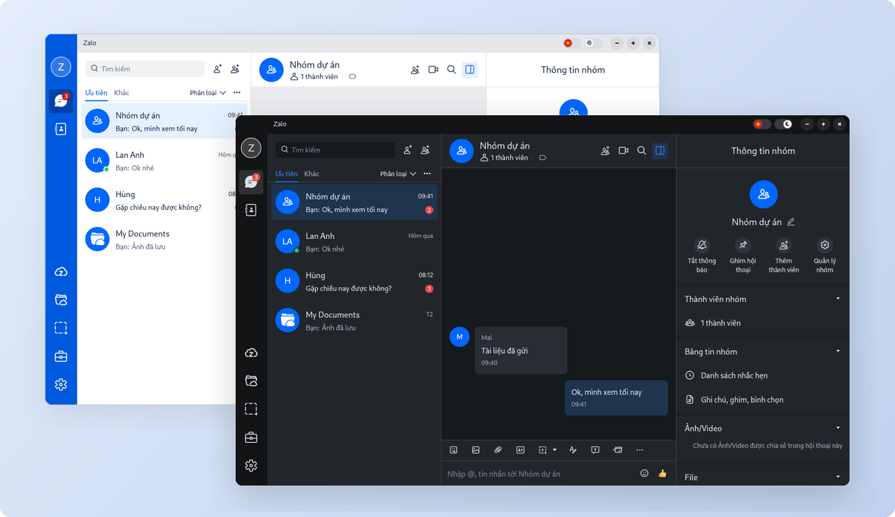
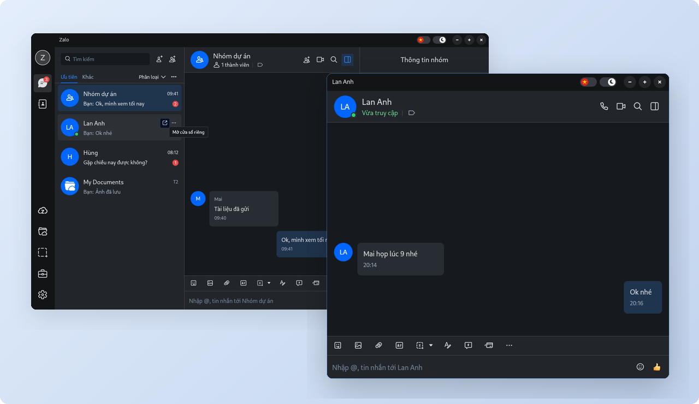
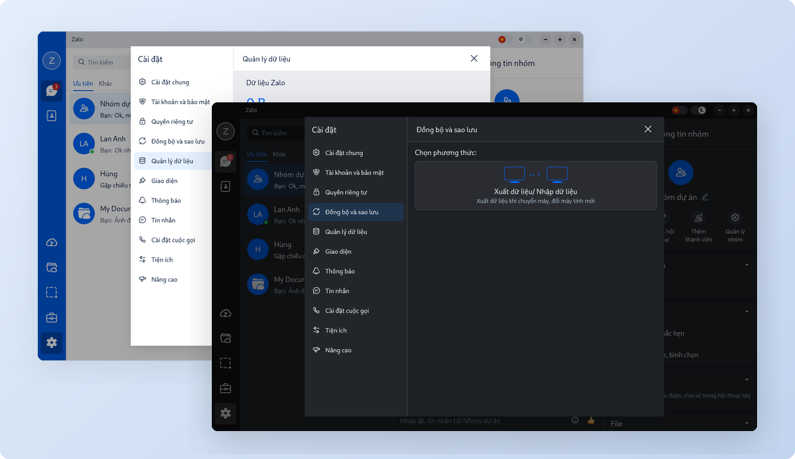
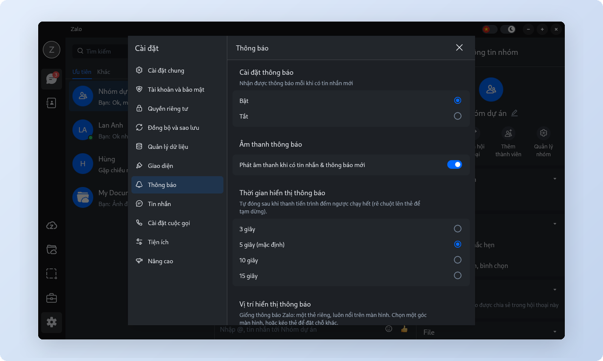
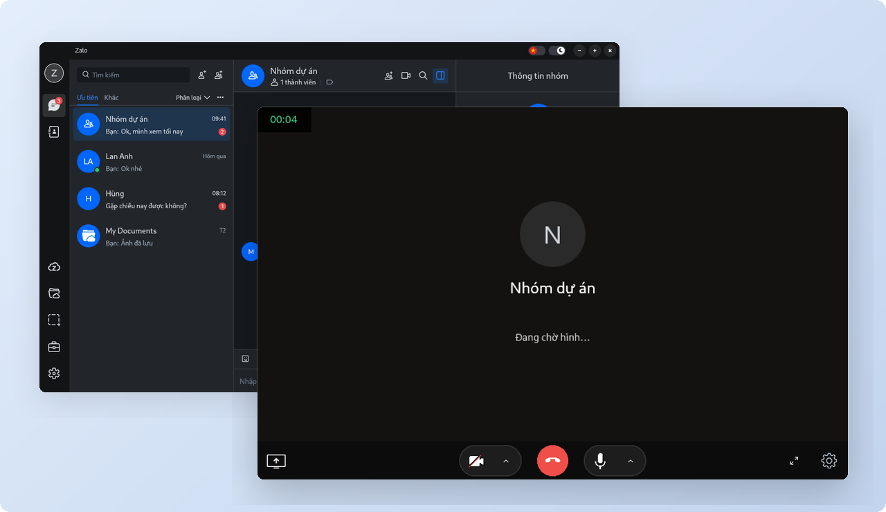

<div align="center">


# Zalo-Rust

**Native, GPU-accelerated Zalo Desktop client — built in pure Rust & GPUI.**

Instant cold startup, silky-smooth native rendering, and a **~15.9 MB** `.deb` package — replacing the heavy Electron/Chromium stack with a unified cross-platform Rust workspace.

<p align="center">
  <a href="Cargo.toml"></a>
  <a href="zalo-linux/README.md"></a>
  <a href="https://github.com/nct89/Zalo-Rust/releases"></a>
  <a href="https://github.com/nct89/Zalo-Rust/actions/workflows/ci.yml"></a>
  <a href="https://github.com/nct89/Zalo-Rust/releases"></a>
  <a href="LICENSE"></a>
</p>

<p align="center">
  <a href="https://github.com/nct89/Zalo-Rust/releases"><strong>Download Release</strong></a> ·
  <a href="#why-zalo-rust-vs-electron">Why Zalo-Rust?</a> ·
  <a href="#visual-showcase">Showcase</a> ·
  <a href="#installation">Installation</a> ·
  <a href="#architecture">Architecture</a> ·
  <a href="#build-from-source">Build</a> ·
  <a href="#support--contact">Contact</a>
</p>

<p align="center">
  
</p>

</div>

---

## Why Zalo-Rust vs. Electron?

Traditional desktop wrappers bundle an entire Chromium browser and Node.js runtime just to render a chat window. **Zalo-Rust** compiles directly to native machine code and renders straight to the GPU via [GPUI](https://www.gpui.rs/), delivering dramatic gains in size, startup speed, and responsiveness:

| Metric | **Zalo-Rust (Native Rust + GPUI)** | Electron-based Client |
|---|---|---|
| **Installer Size (`.deb`)** | **~15.9 MB** *(stripped native binary + fonts & sounds)* | ~150–250+ MB *(bundles Chromium + Node.js)* |
| **Cold Startup** | **Instant** — preloads SQLite state & renders on first frame | Multi-second Chromium + JS bundle bootstrap |
| **UI Rendering & Scroll** | **GPU-accelerated (Vulkan / DirectX 11 / Metal)** — smooth 60–120 FPS, virtualized lists, 60 FPS wave reactions | DOM/CSS layout & JS garbage-collection pauses |
| **Memory Footprint** | **Single lightweight native process** + idle OCR memory release | Multiple Chromium processes (main, renderer, GPU, utility) |
| **Native OS Integration** | Linux (Wayland/X11 CSD, SNI/DBusMenu/XEmbed, XDG Portals), Windows (DWM, Win32 tray, COM dialogs, WASAPI), macOS (Metal, `NSStatusItem`, CoreAudio) | Generic browser window & Electron tray shim |

## Visual Showcase

<table>
  <tr>
    <td width="50%" valign="top">
      
      <p align="center"><strong>Separate Chat Windows (Pop-out)</strong><br />Detach any conversation into its own lightweight native window while staying live-synced with the main workspace.</p>
    </td>
    <td width="50%" valign="top">
      
      <p align="center"><strong>Message Sync &amp; Backup</strong><br />Phone ↔ PC Sync 2 (<code>zalo-sync</code>), PC-to-Phone Backup (<code>zalo-backup</code>), local SQLite storage, and data export/import.</p>
    </td>
  </tr>
  <tr>
    <td width="50%" valign="top">
      
      <p align="center"><strong>Non-Focus-Stealing Notifications</strong><br />Floating cards with smooth countdown progress bar, hover-pause, drag-anywhere placement, group collage avatars, and D-Bus tray fallback.</p>
    </td>
    <td width="50%" valign="top">
      
      <p align="center"><strong>Native Voice &amp; Video Calls</strong><br />Pure-Rust ZRTP/SRTP/RTP/RTCP call engine bridged directly to PulseAudio/PipeWire and V4L2 cameras.</p>
    </td>
  </tr>
</table>

## Features

- **Native GPU-Accelerated UI (`zalo-gpui`)**: Instant startup on **Linux (Wayland & X11)**, **Windows (DirectX 11 / Win32)**, and **macOS (Metal)**, custom client-side window decorations with a live release-version badge in the title bar, Light / Dark / System themes, custom chat wallpapers, Vietnamese / English localization, and built-in **About** & **Contact** dialogs.
- **Complete Messaging Workflow**:
  - QR login with per-account data isolation on switch/logout, resilient WebSocket realtime engine with automatic reconnect, read/typing sync, and multi-window pop-out chats.
  - Official Zalo reaction icons with **press-and-hold + smooth 60 FPS dock-wave picker**, stickers & emoji tiles, replies, forwarding, pinning, starring, full-text local search, hidden conversations, and screen lock.
  - HD photo/video/voice/file transfers with pending attachment editor, built-in region/window screenshot overlay (X11 & Windows GDI), link previews, and a native media viewer with **Photo Live-Text OCR**.
- **Phone ↔ PC Sync & Backup**:
  - **Sync 2 (`zalo-sync`)**: Phone-to-PC message synchronization (`socket 590/591/592`, protobuf `SyncChunk`, `libzproto_wasm_bg`).
  - **Backup (`zalo-backup`)**: PC-to-phone backup pipeline (`socket 630–634`, `/api/backuppc2mb/upload`, `libzproto_backup_wasm_bg`).
  - Both WASM crypto modules are staged inside release packages (`share/zalo-rust/wasm/` or `wasm/`) and also embedded in the binary as an automatic fallback for standalone runs.
- **Native Voice & Video Calls (`zcall-*`)**: Pure-Rust call state machine (`ZRTP` / `SRTP` / `RTP` / `RTCP`, P2P NAT traversal, adaptive bitrate, WebRTC AEC3 + RNNoise AI noise suppression, Wayland PipeWire / X11 / Windows GDI multi-monitor screen sharing) bridged to PulseAudio/PipeWire + V4L2 on Linux, WASAPI + DirectShow on Windows, and CoreAudio on macOS.
- **First-Class Desktop Integration (`zalo-shell` / `zalo-shell-win` / `zalo-shell-mac`)**:
  - Floating notification popups that never steal keyboard/mouse focus, with configurable timeout (3–15s), countdown bar, and group collage avatars — plus OS fallback notifications (freedesktop D-Bus on Linux, `Shell_NotifyIconW` `NIF_INFO` on Windows, Notification Center on macOS).
  - **Linux**: StatusNotifierItem + DBusMenu (auto-reconnect) and X11 XEmbed fallback (`tray-xembed`), Unity launcher unread badges, and XDG Portal background support.
  - **Windows**: Native Win32 notification-area tray (`Shell_NotifyIconW` with dynamic unread badge `HICON`, native context menu, `WM_TASKBARCREATED` recovery), COM `IFileOpenDialog` file/folder pickers, Named Pipe single-instance IPC, `HKCU\...\Run` autostart, DWM Aero Snap / Win11 caption controls, and `RegisterHotKey` global shortcuts.
  - **macOS**: Menu bar (`NSStatusItem`), Dock badges, and LaunchAgent support.
- **Built-in Codecs & Optional On-Device OCR**: Native JPEG XL (`zjxl`), Lanczos3 thumbnails (`zimage`), and optional PP-OCR live-text extraction on dynamically loaded ONNX Runtime (`zocr`) with automatic idle memory release.

## Installation

### Prebuilt Packages (Linux, Windows & macOS)

Download the latest release from [**GitHub Releases**](https://github.com/nct89/Zalo-Rust/releases):

- **Debian / Ubuntu / Linux Mint / Pop!_OS (`.deb`, ~15.9 MB)**:
  ```bash
  sudo apt install ./zalo-linux_<version>_amd64.deb
  ```
- **Portable Linux tarball (`.tar.gz`, ~22.5 MB)**:
  ```bash
  tar -xzf zalo-linux-<version>-linux-x86_64.tar.gz
  ./zalo-linux-<version>-linux-x86_64/bin/zalo-gpui
  ```
- **Windows 10/11 (`.zip` Portable & `-setup.exe` Installer)**:
  - **Installer**: Run `Zalo-<version>-windows-x86_64-setup.exe` (Inno Setup — creates Start Menu / Desktop shortcuts and optional autostart; no Electron or WebView2 required).
  - **Portable**: Extract `Zalo-<version>-windows-x86_64.zip` and run `zalo-gpui.exe` directly.
- **macOS App Bundle (`.zip`)**:
  Download `Zalo-<version>-macos-<arch>.zip`, extract `Zalo.app`, and move it to `/Applications` (ad-hoc signed; right-click → Open on first launch if prompted by Gatekeeper).
- **Interactive Linux Setup Wizard (Desktop Integration & Optional OCR Pack)**:
  ```bash
  zalo-gpui --install
  ```
  Installs the `.desktop` entry, application icons (32–256px), runtime fonts, call sounds, and optionally downloads & SHA-256-verifies the ONNX Runtime + PP-OCR model pack.

Other Linux packaging recipes (`.rpm`, Arch `PKGBUILD`, `AppImage`, `Flatpak`) are available in [zalo-linux/packaging/](zalo-linux/packaging/README.md). All release packages bundle runtime fonts, call sounds, Sync/Backup WASM crypto modules, and `protocol.json`.

## Architecture

All OS-independent protocol, sync, backup, storage, media, and call-engine crates live in `core/` inside a single unified Cargo workspace, so upstream Zalo protocol updates only need to be applied **once** across Linux, Windows, and macOS.

```text
Zalo-Rust/
├── Cargo.toml         # Unified cross-platform Rust workspace manifest
├── protocol.json      # Canonical Zalo protocol parameters (zpw_ver, api_type, User-Agent)
├── core/              # 11 OS-independent pure-Rust crates shared across platforms
├── assets/            # Shared fonts, emoji tiles, reaction icons, call sounds, crypto WASM
├── vendor/            # Linux libc compatibility patch for xattr 0.2.3
├── docs/              # Architecture, sync/backup design notes & UI showcase mockups
├── zalo-linux/        # Shared GPUI client + Linux crates & .deb / .rpm / Arch / AppImage / Flatpak packaging
├── zalo-windows/      # Windows Win32 tray/COM shell, WASAPI call bridge, and .zip / Inno Setup packaging
└── zalo-macos/        # macOS menu bar, CoreAudio call bridge, and .app packaging
```

### Workspace Crates

| Layer | Crate | Platform | Responsibility |
|---|---|---|---|
| `core/` | `zalo-core` | Cross-platform | XDG/platform paths and release version utilities |
| `core/` | `zalo-protocol` | Cross-platform | AES/CBC, ParamCipher v2, request signing, dynamic `protocol.json` overrides |
| `core/` | `zalo-client` | Cross-platform | REST API client, device identity, QR login, realtime WebSocket, media transfers |
| `core/` | `zalo-storage` | Cross-platform | Local SQLite database for threads, messages, users, search, and ZDB4 decryption |
| `core/` | `zalo-sync` | Cross-platform | Phone-to-PC Sync 2 engine (`590/591/592`, protobuf `SyncChunk`, WASM crypto) |
| `core/` | `zalo-backup` | Cross-platform | PC-to-phone backup packer & pipeline (`630–634`, upload API, guards, WASM crypto) |
| `core/` | `zalo-design` | Cross-platform | Design tokens, light/dark color palettes, layout constants, localized strings |
| `core/` | `zcall-core` | Cross-platform | Call engine state machine, ZRTP/SRTP/RTP/RTCP wire format, NAT traversal |
| `core/` | `zimage` | Cross-platform | Thumbnail resizing (Lanczos3, JPEG/PNG) |
| `core/` | `zjxl` | Cross-platform | JPEG XL decode, resize, and lossless encode |
| `core/` | `zocr` | Cross-platform | PP-OCR text recognition via dynamically loaded ONNX Runtime |
| `zalo-linux/` | `zalo-shell` | Linux (`zbus`, `x11rb`) | System tray (SNI/DBusMenu/XEmbed), freedesktop notifications, single-instance IPC, XDG portals & Wayland screencast |
| `zalo-linux/` | `zcall-audio` | Linux (PulseAudio/PipeWire) | Call audio capture, playout, and in-process APM (AEC3 + RNNoise) |
| `zalo-linux/` | `zcall-engine` | Linux (V4L2) | Native call media engine (`zcall-native`) bridging `zcall-core` |
| `zalo-linux/` | `zalo-gpui` | Linux + Windows + macOS (GPUI) | Native GPU desktop client (X11/Wayland on Linux, DirectX 11/Win32 on Windows, Cocoa/Metal on macOS) |
| `zalo-windows/` | `zalo-shell-win` | Windows (Win32 / COM) | System tray (`Shell_NotifyIconW`) + unread badge `HICON`, `NIF_INFO` notifications, `IFileOpenDialog` pickers, Named Pipe single-instance IPC, `HKCU\...\Run` autostart, `RegisterHotKey` |
| `zalo-windows/` | `zcall-audio-win` | Windows (WASAPI) | Shared-mode WASAPI capture and playback via `cpal`, resampled to 16 kHz mono for calls |
| `zalo-windows/` | `zcall-engine-win` | Windows | Opus call audio bridge & multi-source jitter mixer on top of WASAPI |
| `zalo-macos/` | `zalo-shell-mac` | macOS | Menu bar (`NSStatusItem`), Dock badge, notifications, file panels, LaunchAgent |
| `zalo-macos/` | `zcall-audio-mac` | macOS (CoreAudio) | Call and media playback through CoreAudio |
| `zalo-macos/` | `zcall-engine-mac` | macOS | Opus call bridge on top of CoreAudio |

## Build from Source

### Prerequisites (Ubuntu / Debian)

Requires **Rust 1.85+** (`rustup`) and native Linux graphics/audio libraries:

```bash
sudo apt-get update
sudo apt-get install -y --no-install-recommends \
  build-essential cmake dpkg-dev nasm pkg-config \
  libasound2-dev libfontconfig1-dev libpulse-dev libssl-dev \
  libvulkan-dev libwayland-dev libxcb1-dev libxcb-randr0-dev \
  libxcb-shape0-dev libxcb-xfixes0-dev libxkbcommon-dev libxkbcommon-x11-dev
```

### Build & Test

```bash
# Build universal release binary (Wayland + X11 + SNI/XEmbed tray)
cargo build --release -p zalo-gpui

# Run the full workspace test suite (single-threaded for V4L2 device tests)
cargo test --workspace -- --test-threads=1

# Launch the client
./target/release/zalo-gpui
```

To build a local `.deb` package:

```bash
bash zalo-linux/packaging/deb/build-deb.sh
```

### macOS

On a Mac with Xcode command-line tools, CMake, and NASM:

```bash
brew install cmake nasm pkg-config
cargo build --release -p zalo-gpui
# .app bundle + zip (ad-hoc signed; automatically uses the workspace version from Cargo.toml)
bash zalo-macos/packaging/build-app.sh
```

Camera and screen share use `ffmpeg` (`brew install ffmpeg`) and need Camera / Screen Recording permission. Details are in [zalo-macos/README.md](zalo-macos/README.md).

### Windows

On Windows 10/11 with **Visual Studio Build Tools** (Desktop development with C++ + Windows 10/11 SDK providing `fxc.exe`), **CMake**, **NASM**, and **Rust 1.85+** (`x86_64-pc-windows-msvc`):

```powershell
# Optional: install NASM & CMake via winget
winget install -e --id NASM.NASM
winget install -e --id Kitware.CMake

# Run Windows platform crate tests
$env:CMAKE_POLICY_VERSION_MINIMUM = "3.5"
cargo test -p zalo-shell-win -p zcall-audio-win -p zcall-engine-win -p zcall-core -- --test-threads=1

# Build release binary, portable .zip, and optional Inno Setup installer (if `ISCC.exe` is installed)
pwsh zalo-windows/packaging/build-windows.ps1
```

Built-in screenshot crop/window-snap overlay and multi-monitor screen sharing run natively via Win32 GDI (`BitBlt` + `DwmGetWindowAttribute`) with zero external binaries; webcam video calls use `ffmpeg -f dshow` (`winget install Gyan.FFmpeg`). Details are in [zalo-windows/README.md](zalo-windows/README.md).

## CLI & Runtime Configuration

### Command-Line Flags

| Flag | Description |
|---|---|
| `--install` / `--setup` | Open the interactive Linux installer & optional OCR setup wizard |
| `--hidden` / `--start-hidden` | Start minimized in the system tray (ideal for autostart entries) |
| `--login` | Force opening the QR login window |
| `--show` | Focus and reveal an already running instance |
| `--toggle-mute` | Toggle notification mute state on the running instance |
| `--quit` | Gracefully shut down the running instance |
| `--allow-multiple` | Allow running multiple instances side by side |

### Runtime Protocol Overrides (`protocol.json`)

When Zalo updates its desktop `zpw_ver` (`client_version`) or `User-Agent`, you can hot-patch without recompiling by placing a `protocol.json` file at `~/.config/zalo-rust/protocol.json` (Linux), `%APPDATA%\zalo-rust\protocol.json` (Windows), `~/Library/Application Support/zalo-rust/protocol.json` (macOS), or beside the executable (see [protocol.json](protocol.json)), or by setting environment variables:

| Environment Variable | Purpose |
|---|---|
| `ZALO_CLIENT_VERSION` | Overrides `zpw_ver` / `client_version` |
| `ZALO_API_TYPE` | Overrides `type` / `zpw_type` |
| `ZALO_USER_AGENT` | Overrides HTTP and WebSocket `User-Agent` |
| `ZALO_PARAM_CIPHER_KEY` | Overrides the 32-byte `ParamCipher` v2 key |
| `ZALO_WASM_DIR` | Optional custom directory containing `libzproto_*_wasm_bg.*.wasm` |
| `ZALO_EMOJI_DIR` | Optional custom directory containing `emoji-pos.json`, `emoji-rc.json`, and the single emoji sprite PNG |
| `ZALO_IMAGES_DIR` | Optional custom directory containing bundled UI PNG assets (`zcall/`, `zcloud-promo.png`) |
| `ZALO_BUILD_VERSION` | Build-time override for the displayed release tag (defaults to workspace `Cargo.toml`) |

## Automation

- **CI ([ci.yml](.github/workflows/ci.yml))**: Validates `protocol.json`, runs full Linux workspace tests & release build, tests OS-independent `core/*` crates across Ubuntu/Windows/macOS, and verifies native macOS & Windows GPUI builds on every push and pull request.
- **Upstream Watcher & PR Analyzer ([zalo-watcher.yml](.github/workflows/zalo-watcher.yml) + [zalo-upstream-diff.py](scripts/zalo-upstream-diff.py))**: Probes official Zalo Windows & macOS download redirects daily, downloads and unpacks `app.asar` when a newer version ships, diffs `zpw_ver` / WASM / `/api/...` endpoints / `STR_*` keys, and automatically opens a labeled Pull Request (`upstream-sync`, `agy-auto`, `release:patch`/`release:minor`).
- **CodeRabbit Automated Review ([.coderabbit.yaml](.coderabbit.yaml))**: Automatically reviews every PR targeting `main` (and every incremental push) with repository-specific Rust/GPUI rules.
- **Antigravity CLI Autonomous Worker ([agy-pr-bot.py](scripts/agy-pr-bot.py))**: Local `systemd --user` daemon that watches official Zalo Desktop releases, opens upstream PRs, invokes `agy` in an isolated `git worktree` to implement updates and resolve CodeRabbit review comments & CI logs, runs `cargo test --workspace`, squash-merges once green (`AUTO_MERGE=true`), bumps/pushes release tags via PAT to trigger GitHub Releases (`AUTO_TAG_RELEASE=true`), fast-forwards clean local `main` (`AUTO_SYNC_LOCAL=true`), and sends OS desktop notifications on new releases (see [scripts/README.md](scripts/README.md)).
- **Auto Tag & Release ([auto-release.yml](.github/workflows/auto-release.yml) + [release.yml](.github/workflows/release.yml))**: Merging a PR labeled `release:patch` / `release:minor` automatically bumps workspace/packaging versions and pushes tag `vX.Y.Z`, triggering cross-platform builds (Linux `.deb` / `.tar.gz`, macOS `Zalo.app` `.zip`, Windows `.zip` / `-setup.exe`).
- **In-App Update Notifications (`updater.rs`)**: Compares the running `APP_VERSION` against GitHub Releases (`releases/latest`) in the background and alerts the user via OS desktop notification, a titlebar version badge indicator, and a one-click download card inside **About / Version info**.

## Support & Contact

- **Email**: [lienhe@truong.it](mailto:lienhe@truong.it)
- **Telegram**: https://t.me/congtruongit
- **Facebook**: https://m.me/congtruongit
- **Donate**: https://truong.me/donate
- **Website**: https://lza.lol

## License

MIT — see [LICENSE](LICENSE).
